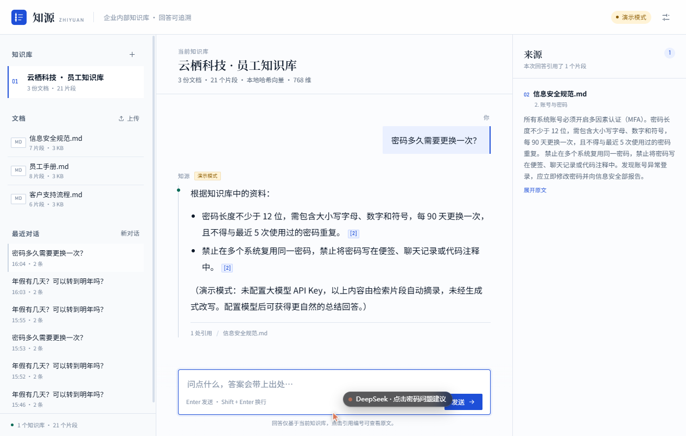
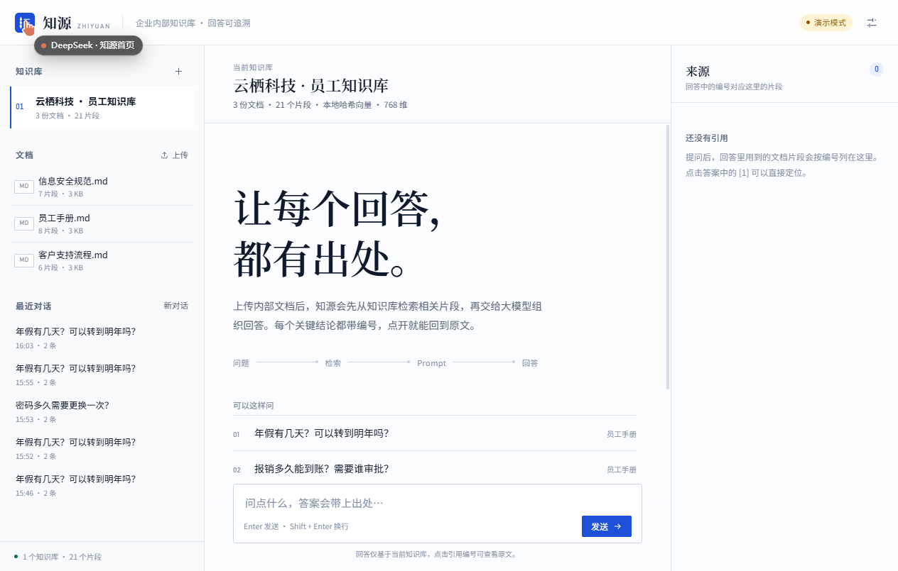
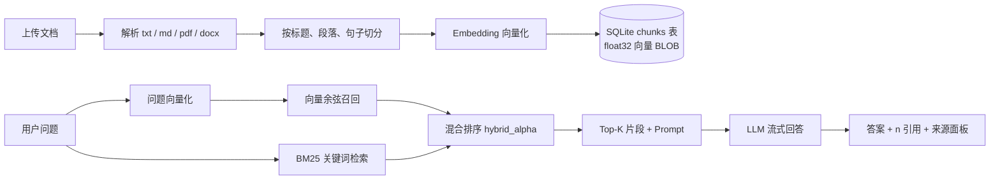

# 知源 ZhiYuan · 基于 RAG 的企业知识库问答系统

> 让每个回答，都有出处。

[](https://www.python.org/)
[](https://fastapi.tiangolo.com/)
[](https://github.com/addprayer/zhiyuan-rag)
[](LICENSE)

知源是一个**本地优先**的企业知识库问答系统：上传内部文档后，它会先把文档切分、向量化并建立索引；提问时先从知识库检索相关片段，再把片段作为「参考资料」交给大模型组织回答，并在每个关键结论后标注 `[n]` 来源。点击编号即可回到原文片段，回答可追溯。

没有配置大模型 API Key 时，系统会自动进入**演示模式**：不调用外部模型，直接从检索片段中摘录答案并保留引用，方便先验证「检索 → 引用」链路。



<details>
<summary>查看空状态界面</summary>



</details>

---

## 目录

- [为什么做这个项目](#为什么做这个项目)
- [功能特性](#功能特性)
- [快速开始](#快速开始)
- [配置大模型](#配置大模型)
- [工作原理](#工作原理)
- [项目结构](#项目结构)
- [API](#api)
- [配置项](#配置项)
- [检索与引用细节](#检索与引用细节)
- [测试](#测试)
- [设计取舍与已知限制](#设计取舍与已知限制)
- [License](#license)

## 为什么做这个项目

企业内部知识通常散落在员工手册、信息安全规范、客服流程、产品文档里。直接把问题交给大模型，会遇到两个问题：

1. **模型不知道企业内部文档**，只能泛泛而谈；
2. **模型容易编造**，而且回答无法核对出处。

知源用 RAG（Retrieval-Augmented Generation，检索增强生成）解决这个问题：

- **先检索**：用 Embedding + 向量检索 + BM25 关键词检索，从知识库找出与问题最相关的片段；
- **再生成**：只把检索到的片段放进 Prompt，要求模型「只依据资料回答」；
- **可追溯**：答案中的 `[1]`、`[2]` 对应右侧来源面板中的原文片段；
- **不硬编**：资料不足时明确说「知识库中没有找到足够的信息」，而不是猜。

## 功能特性

- **多知识库**：按部门/项目拆分知识库，互不干扰。
- **文档上传**：支持 `.txt`、`.md`、`.markdown`、`.pdf`、`.docx`，单文件最大 20 MB。
- **自动解析与切分**：按标题、页码、段落和句子边界切分，默认 520 字 / 80 字重叠。
- **混合检索**：向量余弦召回 + BM25 关键词排序，默认 `hybrid_alpha=0.65`。
- **流式回答**：SSE 逐字输出，首字更快；回答完成后按实际引用过滤来源。
- **来源引用**：答案中的 `[n]` 可点击，右侧展示文档名、章节、页码、相似度和原文。
- **演示模式**：没有 API Key 也能跑通完整检索与引用流程。
- **本地启动窗口**：`启动.bat` 打开 Tkinter 小窗口，一键启动/停止服务并打开浏览器。
- **会话历史**：自动保存对话，可重新打开继续追问。
- **设置面板**：在页面内配置 LLM、Embedding 和检索参数，支持测试连接。
- **本地优先**：默认数据全部存放在项目 `data/` 目录，不需要额外数据库服务。

## 快速开始

### 环境要求

- Python **3.10+**（本项目在 Python 3.14 上开发与测试）
- Windows / macOS / Linux
- 无需 GPU；本地哈希向量模式不需要下载模型

### 方式一：双击启动窗口（Windows，推荐）

```powershell
# 1. 安装依赖（首次）
python -m pip install -r requirements.txt

# 2. 双击 启动.bat
#    或双击 start.bat
```

在启动窗口中点击「启动服务」，服务就绪后会自动打开浏览器。关闭窗口时会停止由它启动的本地服务。

也可以用命令行打开启动窗口：

```powershell
python launcher.py
# 指定端口 / 不自动打开浏览器
python launcher.py --port 8000 --no-browser
```

### 方式二：命令行启动

```powershell
python -m venv .venv
.venv\Scripts\activate          # macOS/Linux: source .venv/bin/activate
python -m pip install -r requirements.txt
python run.py
```

打开 <http://127.0.0.1:8000>。

首次启动会自动创建演示知识库「云栖科技 · 员工知识库」，并导入 `samples/` 下的 3 份示例文档：

- `samples/员工手册.md`
- `samples/信息安全规范.md`
- `samples/客户支持流程.md`

可以直接问：

- 年假有几天？可以转到明年吗？
- 报销多久能到账？需要谁审批？
- 每周可以远程办公几天？
- 密码多久需要更换一次？

### 克隆仓库

```powershell
git clone https://github.com/addprayer/zhiyuan-rag.git
cd zhiyuan-rag
python -m pip install -r requirements.txt
python run.py
```

## 配置大模型

默认使用 DeepSeek 的 OpenAI 兼容接口：

| 配置 | 默认值 |
|---|---|
| Base URL | `https://api.deepseek.com/v1` |
| Model | `deepseek-chat` |

有两种配置方式。

### 方式一：页面内设置（推荐）

打开页面右上角「设置」，填入 API Key、Base URL、模型名，点击「测试连接」，保存即可。设置会写入 `data/settings.json`，只保存在本机。

### 方式二：环境变量

```powershell
$env:ZHIYUAN_LLM_API_KEY = "sk-..."
$env:ZHIYUAN_LLM_BASE_URL = "https://api.deepseek.com/v1"
$env:ZHIYUAN_LLM_MODEL = "deepseek-chat"
python run.py
```

也支持任意 OpenAI 兼容服务，例如：

```powershell
$env:ZHIYUAN_LLM_BASE_URL = "https://api.openai.com/v1"
$env:ZHIYUAN_LLM_MODEL = "gpt-4o-mini"
$env:ZHIYUAN_LLM_API_KEY = "sk-..."
```

> 配置优先级：内置默认值 < 环境变量 < `data/settings.json`（设置面板保存的值优先）。API Key 会以明文保存在本机 `data/settings.json`，该目录已被 `.gitignore` 排除，请不要把 `data/` 提交到仓库或分享给他人。

### Embedding 模式

| 模式 | 说明 |
|---|---|
| `local`（默认） | 本地 signed feature hashing，768 维，中文单字+双字 + 英文词；无需下载模型、无需联网，开箱即用。 |
| `openai` | 任意 OpenAI 兼容 `/embeddings` 接口，例如 OpenAI `text-embedding-3-small`、硅基流动 `BAAI/bge-m3`。语义效果更好，适合生产。 |

在设置面板切换 Embedding 模式后，如果已有知识库是用另一种模式建的，页面会提示**重建索引**。点击「重建索引」即可按新模型重新向量化。

## 工作原理



### 一次问答的完整流程

1. **文档入库**
   - 上传文件保存到 `data/uploads/`；
   - `app/ingest.py` 解析文本：TXT/MD 直接读，PDF 用 `pypdf`（回退 `PyPDF2`），DOCX 用 `python-docx`；
   - `app/chunking.py` 按标题/页码/段落/句子切分，带重叠；
   - `app/embeddings.py` 生成向量，`app/vector_store.py` 把 float32 向量打包成 BLOB 存入 SQLite `chunks` 表。

2. **问题检索**
   - `app/retrieval.py` 先对问题做向量化，扫描当前知识库的 chunk 向量，计算余弦相似度；
   - 同时计算 BM25 关键词分数并归一化；
   - 按 `alpha * 向量分 + (1 - alpha) * 关键词分` 融合，过滤低分片段，每个文档最多取 3 段，最终取 Top-K（默认 5）。

3. **Prompt 组装**
   - `app/prompts.py` 把片段格式化成带编号的「参考资料」；
   - System Prompt 明确要求：只依据资料、关键结论标 `[n]`、资料不足要直说、冲突要分别标注来源。

4. **回答与引用**
   - `app/llm.py` 调用 OpenAI 兼容的 `/chat/completions`，以 SSE 流式返回；
   - 前端把 `[n]` 渲染成可点击的引用按钮；
   - 回答结束后，`citedSources()` 只保留答案真正引用到的来源，避免「检索到但没用上」的片段混进引用列表。

### 关于「向量数据库」

本项目没有引入 Chroma / FAISS / Milvus 等外部向量库，而是把向量直接存在 SQLite 的 `chunks` 表里，用 NumPy 做余弦扫描。这样做的好处是：

- 零额外服务、零额外端口，`python run.py` 就能跑；
- 避免在 Python 3.14 上踩向量库二进制依赖的坑；
- 数据只有一份 SQLite 文件，备份/迁移简单。

`app/vector_store.py` 是唯一的向量访问边界。数据量变大时，可以把 `VectorStore.search()` 替换成 pgvector、Milvus、Qdrant 或 FAISS，而不需要改检索和 API 层。

## 项目结构

```text
zhiyuan-rag/
├─ app/
│  ├─ main.py            # FastAPI 入口、静态文件、生命周期
│  ├─ config.py          # 配置与 data/settings.json 读写
│  ├─ db.py              # SQLite schema 与连接
│  ├─ schemas.py         # Pydantic 请求模型
│  ├─ text_utils.py      # 中文分词、分句、摘要片段
│  ├─ chunking.py        # 标题感知的文档切分
│  ├─ embeddings.py      # 本地哈希 / OpenAI 兼容 Embedding
│  ├─ vector_store.py    # float32 向量打包、余弦检索
│  ├─ retrieval.py       # 向量 + BM25 混合检索
│  ├─ prompts.py         # System Prompt、上下文拼装、演示回答
│  ├─ llm.py             # OpenAI 兼容 Chat Completions 客户端
│  ├─ ingest.py          # 文档解析、入库、重建索引、演示数据
│  └─ api/
│     ├─ system.py       # /api/health、/api/stats
│     ├─ knowledge.py    # 知识库、文档、搜索
│     ├─ chat.py         # SSE 问答、会话
│     └─ settings.py     # 设置、测试连接
├─ static/
│  ├─ index.html         # 单页界面
│  ├─ styles.css         # 三栏布局与设计 token
│  ├─ app.js             # 原生 JS：SSE、引用、上传、设置
│  └─ favicon.svg
├─ samples/              # 演示文档（员工手册、信息安全、客服流程）
├─ tests/
│  ├─ test_core.py       # pytest 单元 + API 测试
│  └─ smoke_check.py     # 对运行中服务的手动冒烟脚本
├─ docs/                 # 截图
├─ data/                 # 运行时数据（已 gitignore）
├─ launcher.py           # Tkinter 启动窗口
├─ 启动.bat / start.bat  # Windows 双击启动
├─ run.py                # uvicorn 入口
├─ requirements.txt
├─ requirements-dev.txt
└─ pytest.ini
```

## API

| 方法 | 路径 | 说明 |
|---|---|---|
| `GET` | `/api/health` | 健康检查，返回名称、版本、当前模式 |
| `GET` | `/api/stats` | 全局统计（知识库/文档/片段数） |
| `GET` | `/api/kbs` | 知识库列表 |
| `POST` | `/api/kbs` | 新建知识库 |
| `PATCH` | `/api/kbs/{kb_id}` | 修改知识库名称/描述 |
| `DELETE` | `/api/kbs/{kb_id}` | 删除知识库（级联删除文档/片段/会话） |
| `GET` | `/api/kbs/{kb_id}/documents` | 文档列表 |
| `POST` | `/api/kbs/{kb_id}/documents` | 上传文档（multipart） |
| `DELETE` | `/api/documents/{doc_id}` | 删除文档 |
| `GET` | `/api/documents/{doc_id}/chunks` | 查看文档片段 |
| `POST` | `/api/kbs/{kb_id}/reindex` | 按当前 Embedding 配置重建索引 |
| `POST` | `/api/search` | 只检索不生成，返回片段与分数 |
| `POST` | `/api/chat` | 提问，SSE 流式返回 `meta/sources/delta/done` |
| `GET` | `/api/conversations` | 会话列表 |
| `GET` | `/api/conversations/{id}` | 会话详情 |
| `DELETE` | `/api/conversations/{id}` | 删除会话 |
| `GET` | `/api/settings` | 读取设置（Key 已脱敏） |
| `PUT` | `/api/settings` | 保存设置 |
| `POST` | `/api/settings/test-llm` | 测试大模型连接 |
| `POST` | `/api/settings/test-embedding` | 测试 Embedding 连接 |

交互式 API 文档：启动后访问 <http://127.0.0.1:8000/docs>。

## 配置项

所有配置都可以用环境变量覆盖；`data/settings.json` 中的值优先级最高。

| 环境变量 | 默认值 | 说明 |
|---|---|---|
| `ZHIYUAN_LLM_BASE_URL` | `https://api.deepseek.com/v1` | OpenAI 兼容 Base URL |
| `ZHIYUAN_LLM_API_KEY` | 空 | 大模型 API Key；为空进入演示模式 |
| `ZHIYUAN_LLM_MODEL` | `deepseek-chat` | 模型名 |
| `ZHIYUAN_LLM_TEMPERATURE` | `0.2` | 生成温度 |
| `ZHIYUAN_LLM_MAX_TOKENS` | `1200` | 最大输出 token |
| `ZHIYUAN_EMBEDDING_PROVIDER` | `local` | `local` 或 `openai` |
| `ZHIYUAN_EMBEDDING_BASE_URL` | `https://api.openai.com/v1` | Embedding API 地址 |
| `ZHIYUAN_EMBEDDING_API_KEY` | 空 | Embedding API Key |
| `ZHIYUAN_EMBEDDING_MODEL` | `text-embedding-3-small` | Embedding 模型名 |
| `ZHIYUAN_TOP_K` | `5` | 最终交给模型的片段数 |
| `ZHIYUAN_CHUNK_SIZE` | `520` | 切分目标长度（字符） |
| `ZHIYUAN_CHUNK_OVERLAP` | `80` | 片段重叠长度 |
| `ZHIYUAN_HYBRID_ALPHA` | `0.65` | 向量分权重，`1.0` 为纯向量 |
| `ZHIYUAN_SEED_DEMO` | `true` | 首次启动是否导入演示知识库 |
| `ZHIYUAN_DATA_DIR` | `./data` | 数据目录 |
| `ZHIYUAN_HOST` | `127.0.0.1` | 监听地址 |
| `ZHIYUAN_PORT` | `8000` | 监听端口 |

## 检索与引用细节

- **切分**：`chunk_size=520`，`chunk_overlap=80`；优先按标题/页码/段落切，长段落再按句子边界切。
- **召回**：向量余弦 Top-120 + BM25 全量打分，融合后过滤 `< 0.06` 的片段。
- **多样性**：同一个文档最多取 3 个片段，避免一个文档占满上下文。
- **引用编号**：Prompt 中的参考资料编号从 1 开始，模型被要求在每个关键结论后标注 `[n]`。
- **来源过滤**：前端解析最终答案中的 `[n]`，只展示被引用的来源；如果答案没有编号，则展示全部检索来源。
- **资料不足**：没有命中片段时直接返回「知识库中没有找到足够相关的内容」，不调用模型编造。
- **冲突处理**：System Prompt 要求不同资料冲突时分别标注来源，而不是合并成一个确定结论。

## 测试

```powershell
python -m pip install -r requirements-dev.txt
python -m pytest tests -q
```

当前测试覆盖：

- 中文分词与分句；
- 本地 Embedding 的归一化与相关性；
- 切分长度、重叠、章节元数据；
- SQLite 入库 + 混合检索命中；
- 演示回答的 FAQ 去重与引用编号；
- FastAPI 健康检查与演示知识库自动创建。

对运行中的服务做手动冒烟：

```powershell
# 先启动服务，默认 8000
python tests/smoke_check.py

# 或指定地址
$env:ZHIYUAN_BASE = "http://127.0.0.1:8123"
python tests/smoke_check.py
```

## 设计取舍与已知限制

- **默认 Embedding 是本地哈希，不是神经语义模型。** 它基于中文单字/双字和英文词的 signed feature hashing，优点是零下载、离线可用、可解释；缺点是同义改写召回不如 `bge-m3` / `text-embedding-3-small`。生产环境建议在设置面板切换到 `openai` 模式并重建索引。
- **SQLite + NumPy 余弦扫描是轻量方案。** 适合几千到几万个 chunk 的单机知识库；数据量到百万级时，请把 `app/vector_store.py` 替换为 pgvector / Milvus / Qdrant / FAISS。
- **单用户、本地优先，没有登录和权限系统。** 默认只监听 `127.0.0.1`，不要直接暴露到公网；如果要多人使用，需要自行加认证、权限和审计。
- **PDF 只提取文本层。** 扫描版 PDF 需要先做 OCR，本项目未内置 OCR。
- **DOCX 只读取段落文本。** 复杂表格、文本框、图片中的文字不会进入知识库。
- **演示模式是抽取式回答。** 它从检索片段中挑选句子并附引用，不是生成式总结；配置 API Key 后才会调用大模型。
- **API Key 以明文保存在本机 `data/settings.json`。** 该目录已加入 `.gitignore`；请不要提交或分享。

## Roadmap

- [ ] 用户登录、知识库权限与审计日志
- [ ] 扫描 PDF OCR、图片/表格解析
- [ ] Cross-encoder rerank
- [ ] 可选 pgvector / Milvus / Qdrant 后端
- [ ] Docker Compose 一键部署
- [ ] 引用高亮定位到 PDF 页码

## License

[MIT](LICENSE) © 2026 addprayer
